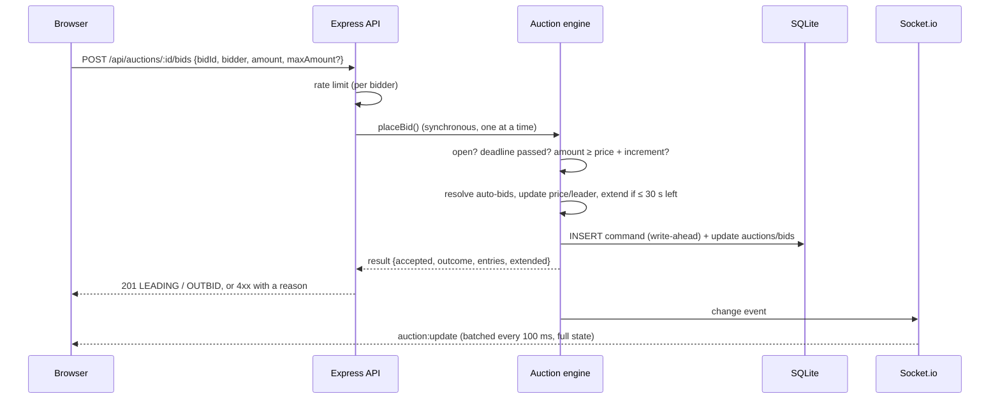

# Lotline: Live Auction Platform

A real-time auction platform where many people can bid on the same lot at the same moment and there is never any doubt about who won.

- **Correct under concurrency:** each auction has a single writer, so two bids can never both win.
- **Fair endings:** a bid in the last 30 seconds adds 30 seconds (anti-sniping).
- **Live:** every watcher sees the new price within about 100 ms over WebSockets.
- **Durable:** everything is stored in SQLite and survives a restart exactly.

Built with **Node.js, Express, Socket.io and SQLite** (built into Node, nothing to install), with a plain HTML/CSS/JS front end and no build step.

---

## Contents

1. [Quick start](#quick-start)
2. [What the brief asked for](#what-the-brief-asked-for)
3. [Design note: scaling to 50,000 auctions](#design-note-scaling-to-50000-auctions)
4. [Features](#features)
5. [How a bid is processed](#how-a-bid-is-processed)
6. [Database](#database)
7. [Pages](#pages)
8. [API reference](#api-reference)
9. [Project structure](#project-structure)
10. [Tests](#tests)
11. [Key decisions and trade-offs](#key-decisions-and-trade-offs)
12. [Next steps](#next-steps)

---

## Quick start

Requires **Node.js 22.5 or newer** (for the built-in `node:sqlite` module).

```bash
npm install
npm run demo      # fresh demo data + simulated bidders → http://localhost:3000
```

| Command | What it does |
|---|---|
| `npm run demo` | Starts with fresh sample lots and simulated bidders (wipes `data/lotline.db`) |
| `npm start` | Starts without bots and keeps all data in `data/lotline.db` between restarts |
| `npm test` | Runs the 30 automated tests |
| `npm run burst -- <lotId> 300` | Fires 300 simultaneous bids at a running server |

> **After pulling new code, restart the server.** An old process keeps serving the old routes.

### Things to try

- **Win a lot:** open any lot, switch **Simulated bidders** off in the bid panel, place a bid, and let the clock run out.
- **Real-time:** open the same lot in two browser windows and bid from both.
- **Auto-bid:** set a maximum, then outbid yourself from the other window and watch your auto-bid answer instantly.
- **Anti-sniping:** bid in the last 30 seconds; the clock extends and everyone watching sees a banner.
- **Concurrency:** on the **System** page, run the stress test (up to 1,000 simultaneous bids), then read the invariant checks.
- **Durability:** stop the server and run `npm start` again. Every lot, bid and hidden auto-bid maximum is restored.

---

## What the brief asked for

| Requirement | How it is met |
|---|---|
| Accept or reject each bid | `placeBid()` in [`src/auction.js`](src/auction.js) checks the auction is open, the amount is a whole number, and it is at least the starting price or current price + increment |
| Extend by 30 s when a bid arrives in the last 30 s | Any bid that moves the price with 30 s or less left adds 30 s, and the close timer is re-armed |
| Stay correct when many people bid at once | Each bid runs as one synchronous step, so there is a single writer per auction. Tested with 500 simultaneous HTTP bids |
| End with exactly one winner | Closing happens once, at the server's deadline. A bid after the deadline is always rejected, even if the timer is late. `GET /api/auctions/:id/verify` re-checks this |

---

## Design note: scaling to 50,000 auctions

*Target: 50,000 auctions at once, up to 200,000 people watching one of them.*

1. **One owner per auction.** Auctions are split across servers by auction ID. Every bid for an auction goes to a single writer: a Redis shard running a Lua script, or one Kafka partition with one consumer. Bids on the same auction are processed one at a time with no distributed locks, while different auctions run fully in parallel.
2. **The bid check is one atomic step.** Check the auction is open → check the amount ≥ price + increment → resolve auto-bids → write price and leader → extend the deadline if 30 s or less remain. This is a single atomic operation (a Lua script, or one synchronous function in this repo), so two bids can never both see the old price.
3. **The server clock decides.** The deadline is checked inside that same step, using the server's clock, never the client's. A timer closes the auction exactly once. If a bid arrives after the deadline but before the timer fires, the bid closes the auction and is rejected. The winner is the leader at close.
4. **Fan-out is separate from bidding.** Auction owners publish changes to pub/sub (Redis or NATS). About 20 stateless WebSocket gateways (~10k connections each) push them to watchers. In the final-seconds rush, updates are batched to at most one every 100 ms per auction and always carry the full latest state, so 200,000 watchers cost one fan-out per batch, not one per bid, and a dropped message never leaves a screen wrong.
5. **Durable, auditable storage.** Each accepted command is written to the database before the bidder is told "accepted". Queryable `auctions`, `bids` and `users` tables are kept in step, with `PRIMARY KEY (auction_id, seq)` so a duplicate bid cannot exist. A crashed owner rebuilds its state by replaying the command log (Postgres + Kafka in production; SQLite here).
6. **Safety at the edges.** Client-generated bid IDs make retries idempotent. Bidders are authenticated and rate-limited at the gateway, and money is stored as whole numbers (paise/cents), never floats.

---

## Features

**Bidding**
- Starting price, minimum increment and an optional **hidden reserve price** ("reserve met / not met" is shown; the amount never is).
- **Auto-bidding:** give a maximum and the engine bids for you, only as much as needed to stay in front. A tie goes to the earlier bidder.
- **Anti-sniping:** a price-moving bid with 30 s or less left adds 30 s.
- **Scheduled lots** that open at a set time.
- **Idempotent bids:** a retried request with the same `bidId` is never counted twice, even after a restart.
- **Rate limiting** per bidder (token bucket) returns `429` when someone floods.
- **Bidder names must contain letters** (e.g. `riya_k`, not `1233`), checked in the browser and enforced by the engine.

**Real-time**
- Socket.io rooms per auction, with live price, bid history, countdown and watcher count.
- Updates are batched to at most 10 per second per auction, each with full state.
- Countdowns follow the **server's** clock (the browser estimates its offset from `/api/time`).

**Demo and operations**
- **Simulated bidders** with private valuations, switchable on or off at runtime from the lot page or the System page.
- **System page:** bids per second, engine latency (p50/p99), sockets, stress test, live database view.
- **Invariant checker:** recomputes every rule from the full bid history.

---

## How a bid is processed



**Auto-bid rules.** Say Ann leads with a hidden maximum of ₹500 and the increment is ₹10:

| Bob bids | Result |
|---|---|
| ₹200 | Ann's auto-bid answers at **₹210**; Ann stays in front (`OUTBID` for Bob) |
| ₹500 | A tie at Ann's maximum: Ann keeps the lead because she bid first |
| ₹120 with a maximum of ₹1,000 | Ann's auto-bid goes to ₹500, Bob leads at **₹510** |

---

## Database

SQLite file: `data/lotline.db` (WAL mode). Schema in [`src/db.js`](src/db.js).

| Table | Purpose |
|---|---|
| `commands` | Append-only write-ahead log of every accepted command (create lot, place bid). This is the source of truth and is replayed on start-up, including hidden auto-bid maximums |
| `auctions` | One row per lot: status, current price, leader, end time, extensions, outcome, winner |
| `bids` | Every bid-history entry. `PRIMARY KEY (auction_id, seq)` makes a duplicate impossible |
| `users` | Bidders and sellers, with their bid and listing counts |

The `auctions` and `bids` tables are written in the same step as the command, and rebuilt from the command log on every start-up, so they can never drift from it. The **System** page shows the row counts and the latest rows of `bids`, read live from the database.

---

## Pages

| Page | What it shows |
|---|---|
| **Explore** `/` | Lot closing next, live counts, filters (live / ending soon / upcoming / ended), categories, search and sort |
| **Lot** `/auction?id=…` | Live price and countdown, quick-bid buttons, auto-bid, bid history, simulated-bidders switch, result and "You won" dialog, Verify button |
| **Sell** `/sell` | Listing form with a live preview: category, cover style, starting price, increment, reserve, duration, scheduled start |
| **My bids** `/activity` | Winning, outbid, won, lost and watched lots, updating live |
| **System** `/system` | Throughput chart, latency, stress test, live database panel, scaling diagram |

---

## API reference

| Method | Path | Body / notes |
|---|---|---|
| `GET` | `/api/auctions` | Query: `status=live\|ending\|upcoming\|ended\|all`, `category`, `q`, `sort=ending\|bids\|price\|newest`, `ids` |
| `POST` | `/api/auctions` | `{ title, description, category, palette, startingPrice, minIncrement, reservePrice?, durationSeconds, startsInSeconds?, seller }` |
| `GET` | `/api/auctions/:id` | Auction + last 50 bid-history entries |
| `GET` | `/api/auctions/:id/history?limit=` | Full bid history, read from SQLite |
| `POST` | `/api/auctions/:id/bids` | `{ bidId, bidder, amount, maxAmount? }` |
| `GET` | `/api/auctions/:id/verify` | Recomputes every invariant from the full history |
| `POST` | `/api/auctions/:id/stress` | `{ count }`: fires N simultaneous bids through HTTP, returns tallies + verification |
| `GET` | `/api/users/:name/activity` | A bidder's lots and state (hidden maximums are never exposed) |
| `GET` / `POST` | `/api/demo/bots` | Read / set `{ "enabled": true }` or `{ "enabled": false }` for the simulated bidders |
| `GET` | `/api/db` | Table row counts + latest stored bids |
| `GET` | `/api/stats`, `/api/time` | Metrics, server clock |

**Bid responses**

| Status | Meaning |
|---|---|
| `201` | Accepted. `outcome` is `LEADING`, `OUTBID` (an auto-bid answered higher) or `MAX_RAISED` |
| `200` | Duplicate retry of an already accepted `bidId` |
| `400` | `INVALID_AMOUNT`, `INVALID_BIDDER`, `MAX_BELOW_AMOUNT` |
| `404` | `NOT_FOUND` |
| `409` | `BID_TOO_LOW` (with `minAcceptable`), `AUCTION_CLOSED`, `NOT_STARTED`, `ALREADY_LEADING` |
| `429` | `RATE_LIMITED` |

**WebSocket events (Socket.io)**

| Room | Join with | Events |
|---|---|---|
| `auction:<id>` | `auction:join` | `auction:snapshot`, `auction:update`, `auction:closed` |
| `lobby` | `lobby:join` | `lobby:snapshot`, `lobby:update` |
| `stats` | `stats:join` | `stats` (every second) |
| everyone | n/a | `demo:bots` when the simulated bidders are switched |

---

## Project structure

```
src/
  auction.js      bidding engine: rules, auto-bid, reserve, timers, verify, replay   ← the core
  server.js       Express API, single bid entry point, stress test, static files
  db.js           SQLite storage: commands log + auctions / bids / users tables
  realtime.js     Socket.io rooms, watcher counts, 100 ms batching
  metrics.js      throughput and latency percentiles
  rate-limit.js   token bucket per bidder
  demo.js         sample lots + switchable simulated bidders
  http-client.js  keep-alive HTTP client used by the stress test
public/
  index.html, auction.html, sell.html, activity.html, system.html
  css/app.css     design system      css/pages.css   page layouts
  js/core.js      shared UI: API, socket, server clock, formatting, dialogs, cards
test/
  auction.test.js engine tests with a fake clock
  http.test.js    HTTP, concurrency, rate limits, SQLite, restart, bots switch, names
scripts/burst.js  fire many simultaneous bids at a running server
```

---

## Tests

`npm test` runs **30 tests** with Node's built-in test runner. Time-based tests use a fake clock, so they run instantly and the same way every time.

- **Rules:** starting price, increment, invalid amounts and names, validation on create.
- **Auto-bid:** proxy answer, challenger beating a maximum, ties, raising your own maximum, hidden maximum never leaked.
- **Reserve:** met and not met.
- **Timing:** extension at exactly 30 s, repeated extensions, late timer, scheduled start, close with no bids.
- **Concurrency:** 1,000 interleaved bids in the engine, plus 500 simultaneous HTTP bids where the highest bid always wins and nothing is counted twice.
- **Durability:** replay gives an identical state; a server restart restores lots, history and hidden maximums from SQLite; rows land in the right tables.
- **Operations:** idempotent retries, rate limiting, the stress endpoint, the simulated-bidders switch.

---

## Key decisions and trade-offs

- **Single writer instead of locks.** `placeBid` is synchronous from start to finish. Node runs one call at a time, so read → check → write can never interleave. This is the per-auction single-writer model from the design note, at the size of one process.
- **Only price-moving bids extend the clock.** Raising your own hidden maximum does not extend it, otherwise a leader could stall an auction forever. The extension is literally `endsAt += 30 s`; resetting to `now + 30 s` instead is a one-line change.
- **Write before acknowledge.** The command row is inserted before the response and the broadcast. In production this would be Postgres plus a Kafka produce with acknowledgements.
- **Whole-number money.** All amounts are integers (rupees here, paise/cents in production), so there are no rounding errors.
- **No front-end build step.** Plain ES modules keep the project easy to run and read. The UI uses subtle frosted glass, page-to-page View Transitions, smooth reordering and number animations, all of which respect `prefers-reduced-motion`.

---

## Next steps

- Real authentication (bidder names are honour-system in this demo)
- Postgres + Kafka in place of SQLite, with log snapshots
- Horizontal scale-out: sharded auction owners and a WebSocket gateway tier, as in the design note
- Payments and seller payouts after a win, plus outbid notifications by email or push
